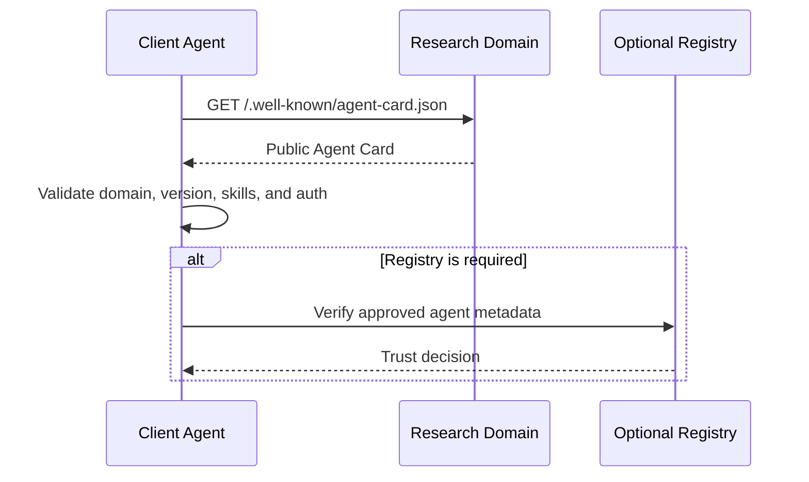
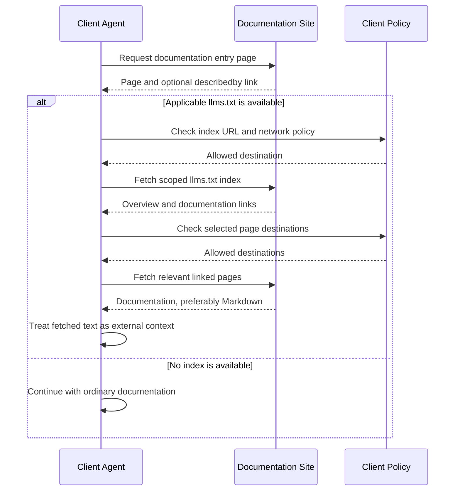
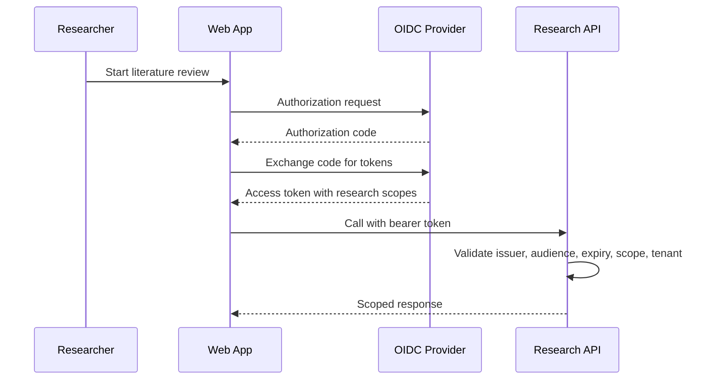
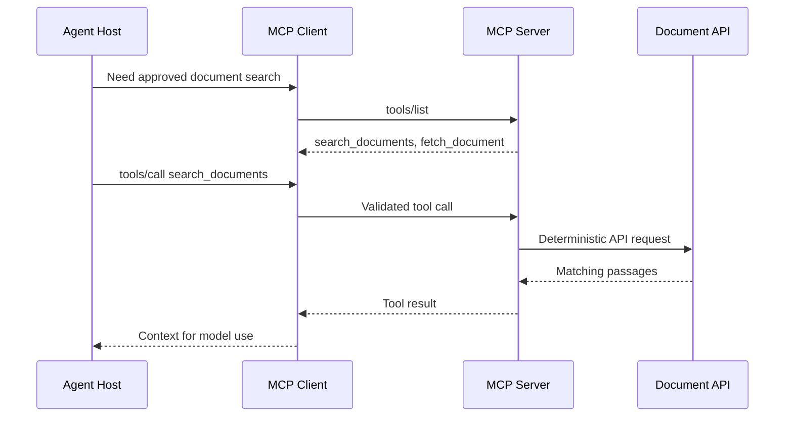
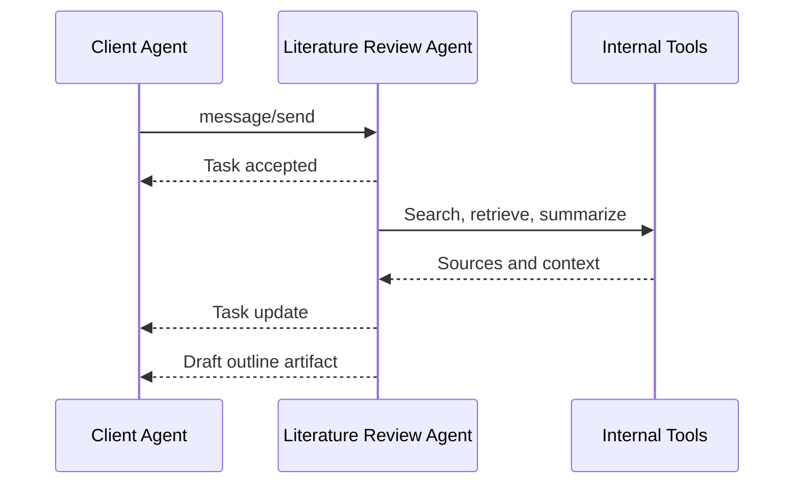
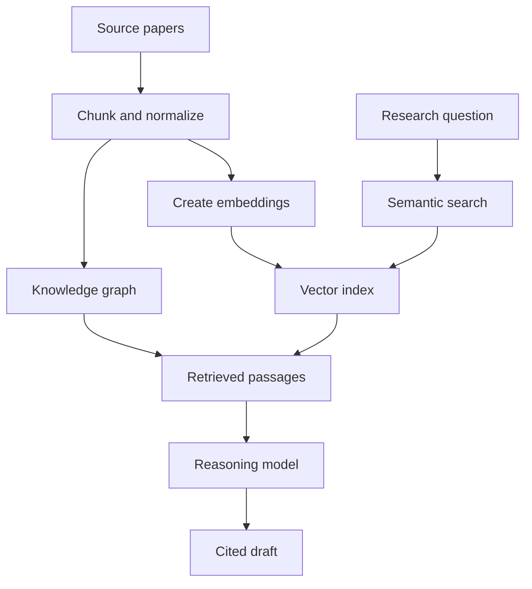
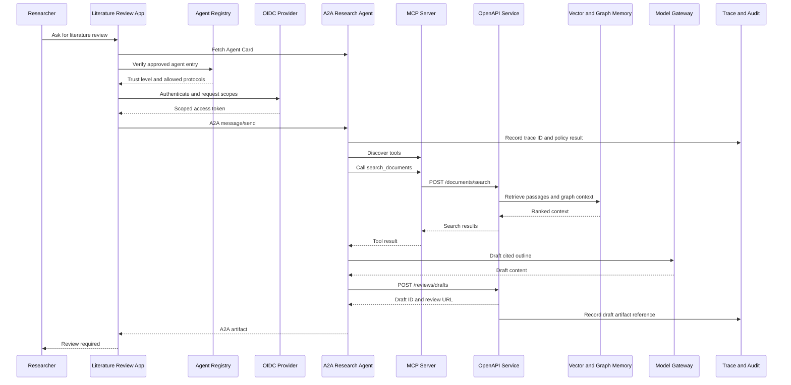

# Architecture Flows

These diagrams show how an agent-native system moves from discovery to application output. The Literature Review Assistant is used as the running example.

## Agent Card Discovery

## Documentation Discovery with llms.txt

This optional deployment flow complements Agent Card discovery. It illustrates the [llms.txt proposal](/concepts/llms-txt), rather than an endpoint implemented by the local demo API. The index may live at the website root or under a documentation path.

The client still validates Agent Cards, API contracts, and credentials separately. Index text and linked documents cannot grant permissions or override user instructions. See [Security and Trust](/guides/security-trust).

## OAuth Delegated Access

## MCP Tool Access

## A2A Task Delegation

## RAG and Knowledge Memory

## Full Stack Sequence

