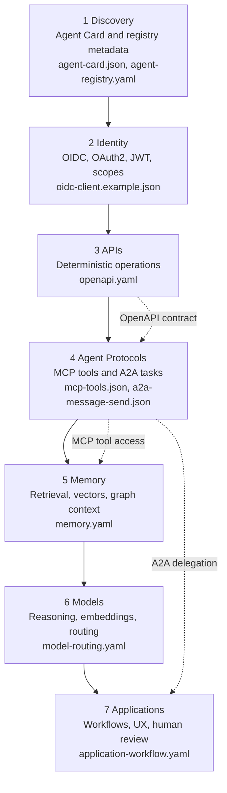

# Architecture Overview

The Agentic Web Stack describes how modern AI agents can be exposed, discovered, integrated, and operated using open standards and emerging protocols.

The architecture treats agent-native systems as a layered web platform:

- Discovery tells agents what exists.
- Identity controls who or what may access it.
- APIs expose deterministic system capabilities.
- Agent protocols expose tools, resources, and task workflows.
- Memory gives agents durable context.
- Models provide reasoning and generation.
- Applications compose the lower layers into useful work.

## Canonical Stack

## Design Goals

- Keep the project vendor-neutral and standards-focused.
- Make every layer independently understandable.
- Show how human-readable documentation and machine-readable artifacts fit together.
- Keep protocol boundaries explicit so implementations remain interoperable.
- Avoid tying the architecture to one vendor, framework, or model provider.

## Reference Artifacts

The architecture uses two kinds of artifacts:

- Human-readable explanations for architecture, security, operations, and technology choices.
- Machine-readable examples for Agent Cards, OpenAPI contracts, identity configuration, MCP tools, A2A messages, memory, model routing, and application workflows.

## Next Step

Read the [technology stack guide](./technology-stack.md) for common implementation technologies, then use the [layer model](./layers.md) for the full stack view and [architecture variants](./variants.md) for deployment shapes.

Then follow the [End-to-End Demo](/guides/end-to-end-demo), inspect [Architecture Flows](./flows.md), and use [Specifications](/specifications/) for machine-readable examples.
