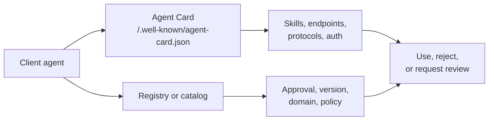

# Agent Discovery

Agent discovery answers: "What agent exists here, what can it do, and what evidence should a client inspect before using it?"

Discovery is not only a lookup step. It is the first trust boundary in the Agentic Web Stack.

## Core Pattern

## What Clients Should Check

- Domain and transport match the expected origin.
- Agent Card version is supported.
- Skills and output modes match the intended task.
- Authentication schemes and required scopes are explicit.
- Registry or catalog metadata confirms approved use when governance requires it.
- Cache headers and ETags are honored so stale metadata does not silently drive work.

## Documentation Discovery

[llms.txt](./llms-txt.md) adds a proposed entry point for finding documentation an agent can use as context. It complements the Agent Card and registry checks above; the client's approval and access policies still govern service use.

## Demo Mapping

The local demo exposes a public Agent Card and a registry entry:

- [agent-card.json](/specs/demo/agent-card.json) describes the agent.
- [agent-registry.yaml](/specs/demo/agent-registry.yaml) describes local approval and trust metadata.
- `GET /.well-known/agent-card.json` serves localized discovery metadata.
- `GET /registry/agents/literature-review-assistant` serves the demo registry entry.

## Related Pages

- [Agent Card](./agent-card.md)
- [Agent Registry](./agent-registry.md)
- [Discovery topic](/topics/discovery)
- [Security and Trust](/guides/security-trust)
