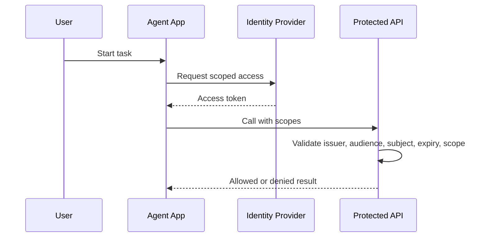

# Identity Delegation

Identity delegation answers: "Who is the agent acting for, which scopes were granted, and how can that access be audited or revoked?"

Agent systems should avoid ambient authority. A tool or remote agent should receive only the scopes needed for the requested work.

## Delegation Model

## Architecture Rules

- Preserve the represented subject, such as a user, service account, organization, or agent.
- Use explicit scopes for each side effect.
- Log policy decisions without logging tokens.
- Keep refresh tokens and long-lived credentials out of agent prompts and memory.
- Require human review for high-impact external actions.

## Demo Mapping

The demo uses local JWTs only for deterministic development:

- `GET /auth/dev-token` issues scoped demo tokens.
- `research:read` allows document search and retrieval.
- `drafts:write` allows draft creation.
- `debug:read` protects local runtime, audit, and trace inspection.

## Related Pages

- [Identity topic](/topics/identity)
- [Security and Trust](/guides/security-trust)
- [Operations and Evaluation](/guides/operations-evaluation)
