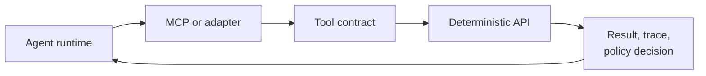

# Tool Use

Tool use is the pattern where an agent invokes deterministic operations outside the model. Tools can search documents, call APIs, create records, fetch files, or trigger workflows.

Tools should be treated as governed software interfaces, not as prompt snippets.

## Tool Boundary

## Design Rules

- Use schemas for tool inputs and outputs.
- Validate arguments before side effects.
- Log tool name, trace ID, policy result, and safe artifact references.
- Keep secrets out of prompts, tool results, logs, and memory.
- Prefer MCP for agent-to-tool interoperability; use direct APIs when a deterministic service call is enough.

## Demo Mapping

The demo exposes two MCP-shaped tools:

- `search_documents`
- `fetch_document`

Their schemas are defined in [mcp-tools.json](/specs/demo/mcp-tools.json).

## Related Pages

- [Model Context Protocol](./mcp.md)
- [MCP vs A2A](./mcp-vs-a2a.md)
- [Agent Protocols topic](/topics/agent-protocols)
