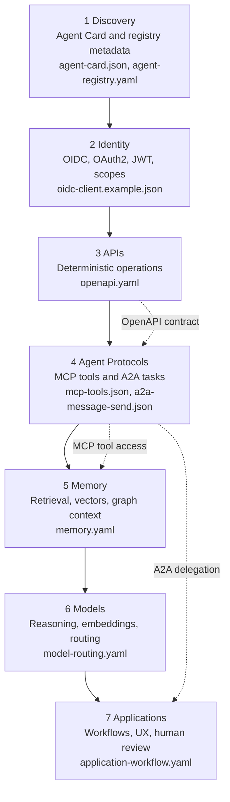

## What This Website Is About

Agentic Web Stack is a practical guide to the emerging web of AI agents. It explains how agent-native systems can be made discoverable, secure, callable, interoperable, stateful, and useful across organizational boundaries.

The site is organized for builders who need to answer concrete architecture questions:

- What metadata should an agent publish so other agents can find it?
- Which identity layer should protect delegated agent access?
- Where do REST, GraphQL, OpenAPI, MCP, and A2A fit together?
- Which memory, model, and application technologies are commonly used?
- Which standards and protocol links should an architecture start from?

## Project Map

This site is the knowledge base for the Agentic Web Stack reference architecture.

## Three Paths

- [Understand the Stack](/architecture/) starts with the canonical layer model, architecture variants, and core concepts.
- [Run the Demo](/guides/run-local-demo) executes the Literature Review Assistant and shows discovery, delegation, policy, trace, and review evidence.
- [Explore References](/references/) collects standards, protocols, timeline history, origins, papers, tools, and glossary definitions.

## Canonical Stack

## Start Here

- [Technology Stack](/architecture/technology-stack) explains the seven stack levels and common technologies for each category.
- [End-to-End Demo](/guides/end-to-end-demo) follows the Literature Review Assistant through every stack layer.
- [Run the Local Demo](/guides/run-local-demo) starts the FastAPI service and executes the deterministic workflow.
- [Layer Model](/architecture/layers) shows the complete reference architecture from discovery to applications.
- [Architecture Flows](/architecture/flows) shows discovery, identity, MCP, A2A, memory, and full-stack diagrams.
- [Architecture Variants](/architecture/variants) shows minimal, enterprise, local/private, and research stack variants.
- [Agent Card](/concepts/agent-card) explains the machine-readable metadata used for agent discovery.
- [Agent2Agent](/concepts/a2a) explains A2A for cross-agent communication and delegation.
- [Model Context Protocol](/concepts/mcp) explains MCP for connecting agents to tools and resources.
- [Topic Guides](/topics/) include example use cases and specification sketches for each stack layer.
- [Specifications](/specifications/) lists machine-readable examples for the reference scenario.
- [Security and Trust](/guides/security-trust) defines trust boundaries and security controls.
- [Decisions](/decisions/) records recommended defaults and tradeoffs.
- [Agentic Web Stack Timeline](/references/timeline) shows how web foundations, model infrastructure, and agent protocols developed over time.
- [Technology Origins](/references/technology-origins) tracks when key technologies emerged, who developed them, and which organizations steward them.
- [Glossary](/glossary) defines the core terms used throughout the documentation.

## Topic Guides

- [Topic Guides](/topics/) are organized into Web Foundations, Agent Runtime, and Application Layer.
- Web Foundations cover [Discovery](/topics/discovery), [Identity](/topics/identity), and [APIs](/topics/apis).
- Agent Runtime covers [Agent Protocols](/topics/agent-protocols), [Memory](/topics/memory), and [Models](/topics/models).
- Application Layer covers [Applications](/topics/applications).

## References

- [References](/references/) collect standards, protocols, timeline history, technology origins, papers, and tools.
