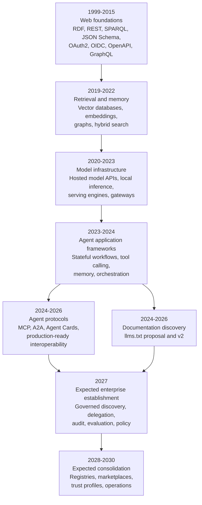

# Agentic Web Stack Timeline

This page shows the Agentic Web Stack as a historical development path: older web standards made services discoverable, callable, and secure; model and retrieval systems made agents useful; agent-specific protocols are now turning those parts into an interoperable agent web.

Use this page as a chronology. Use [Technology Origins](./technology-origins.md) when you need detailed provenance, steward organizations, and source links for individual technologies.

## How to Read the Timeline

The dates below mix three kinds of milestones:

- Invention years: when a concept, protocol, or project first appeared publicly.
- Establishment years: when the technology became a practical default or foundation for production architecture.
- Expected establishment years: forward-looking estimates for where agentic web patterns may become ordinary integration infrastructure.

Future entries are architecture expectations, not release commitments. They describe when the pattern is likely to become stable enough for default enterprise use if current standards, tooling, and governance continue to mature.

## Timeline View

## Chronological Milestones

| Period | Stack development | Representative technologies | Status |
| --- | --- | --- | --- |
| 1999-2000 | The web gains a vocabulary for linked data and architectural constraints for networked services. | RDF, REST | Established foundation |
| 2008-2015 | Machine-readable contracts and web identity mature. This creates the substrate agents later need: queryable knowledge, structured payload validation, delegated authorization, user identity, and API descriptions. | SPARQL, JSON Schema, OAuth2, OpenID Connect, OpenAPI, GraphQL | Established foundation |
| 2019-2022 | Retrieval and semantic search become practical enough for application developers. Agent memory starts to look less like a single database choice and more like a combination of vectors, graphs, relational data, and document stores. | Weaviate, Qdrant, Chroma, pgvector, Neo4j, RDF stores | Established infrastructure |
| 2020-2023 | Hosted model APIs, local inference, and serving engines make model capability composable. Applications can call reasoning and generation as infrastructure, while local runtimes improve control over cost, data, and deployment. | OpenAI API, Claude, Gemini, llama.cpp, Ollama, vLLM, LiteLLM | Established infrastructure |
| 2023-2024 | Agent application frameworks turn prompts, tools, state, memory, and control flow into software architecture concerns. Teams start building repeatable agent workflows instead of one-off chat integrations. | LangGraph, CrewAI, Semantic Kernel, early ADK patterns | Emerging default |
| September 2024 | Jeremy Howard proposes an agent-readable entry point to website documentation. | [llms.txt](/concepts/llms-txt) | Community proposal |
| 2024-2025 | Agent-specific protocol layers appear. MCP standardizes how agents and AI applications connect to tools and context. A2A and Agent Cards standardize how independent agents describe themselves, delegate tasks, and exchange artifacts. | MCP, A2A, Agent Card | Emerging standard layer |
| 2026 | Production-ready agent interoperability becomes credible, especially where protocols have stable specifications, governance, SDKs, examples, and security guidance. | A2A v1.0, maturing MCP specification work, agent registries, policy gateways | Early establishment |
| 2027 | Expected establishment year for governed enterprise agent interoperability. Common production stacks should have explicit discovery metadata, scoped delegation, protocol gateways, audit trails, evaluation suites, and human override paths. | Agent Cards, A2A, MCP, OAuth2/OIDC, OpenAPI, policy engines, evaluation harnesses | Expected establishment |
| 2028-2030 | Expected consolidation years for the broader agentic web. Registries, marketplaces, trust frameworks, certification profiles, and cross-organization agent operations may become normal architecture features. | Agent registries, capability marketplaces, trust profiles, compliance controls, multi-agent operations | Expected establishment |

The [llms.txt v2 revision](https://llmstxt.org/changes.html), published in August 2026, clarifies path scope and link discovery. It develops alongside agent protocols as a documentation convention; see [Technology Origins](./technology-origins.md#documentation-discovery) for provenance.

## Stack Interpretation

The Agentic Web Stack was not invented in one step. It is a layering of earlier web engineering decisions:

1. Web standards made services addressable, linkable, and describable.
2. Identity standards made delegated access and user representation auditable.
3. API description standards made software capabilities machine-readable.
4. Retrieval and model infrastructure made agents useful across large context spaces.
5. Agent frameworks made agent behavior controllable enough to build applications.
6. Agent protocols are making tool use and agent collaboration interoperable across vendors, organizations, and runtimes.

The stack is therefore less a replacement for the web than an extension of it. Agent Cards reuse well-known discovery ideas. A2A and MCP sit above HTTP, JSON, identity, schemas, and transport infrastructure. Memory, models, and applications sit above those protocol contracts and turn the contracts into useful work.

## Expected Future Shape

By the late 2020s, a mature agentic web stack should make these capabilities ordinary:

- Agents can publish stable, signed, machine-readable capability metadata.
- Agents can discover each other through well-known URLs, registries, or private catalogs.
- Delegation is scoped, logged, revocable, and tied to a human, service account, or organization.
- Tools and resources are exposed through MCP or compatible adapters instead of bespoke prompt glue.
- Cross-agent work uses A2A-style tasks, artifacts, streaming updates, and asynchronous callbacks.
- Evaluation, observability, and policy checks are part of the agent runtime, not afterthoughts.
- Organizations can reason about agent trust using the same rigor they apply to APIs, identities, and supply chains.

The practical question for builders is not whether every future system uses the same framework. It is whether the system exposes enough standard metadata, identity, API, protocol, memory, model, and operational evidence for another trusted system to understand and use it.

## Related Pages

- [Technology Stack](/architecture/technology-stack) - The seven stack levels and where each technology belongs.
- [Technology Origins](./technology-origins.md) - Detailed origin, steward, and reference links for major technologies.
- [Architecture Flows](/architecture/flows) - Diagrams showing how discovery, identity, protocols, memory, and applications interact.
- [Security and Trust](/guides/security-trust) - Trust boundaries and controls required for production agent systems.
